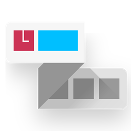

# Schedule.is 扩展端

### Time.is 大屏课表与倒计时联动扩展

  <a href="https://github.com/SatinAu-Zelynn/Schedule.is-Plugin">🔗 前往配套 ClassIsland 插件端仓库</a>

## 项目简介

**Schedule.is 扩展端** 是一款独立的 Chromium 浏览器扩展（支持 Microsoft Edge / Google Chrome 等）。

当浏览器处于 [Time.is/clock](https://time.is/clock) 授时大屏页面时，本扩展会自动注入一套契合大屏审美的高级毛玻璃 HUD 卡片，实时拉取并展示本地 ClassIsland 中的科目安排与上下课倒计时。

## 功能特性

- **沉浸式大屏 UI**：专为投影幕布与班级大屏设计的暗色毛玻璃卡片，美观不遮挡大钟
- **状态流转指示**：动态胶囊徽章高亮显示当前教学状态（绿色上课、琥珀色课间、灰色空闲）
- **核心信息同屏**：当前科目、下一节预告与距离铃响的倒计时一目了然
- **解决混合内容限制**：采用 Manifest V3 Service Worker 中继转发，完美解决 HTTPS 页面直连本地 HTTP 的 Mixed Content 拦截
- **秒级自动同步**：1 秒级后台轮询，ClassIsland 课表切换即刻在大屏同步变动

## 配套组件

> ⚠️ 本扩展依赖本地运行的 ClassIsland 插件提供数据源，使用前请确保已安装：
> - **ClassIsland 插件端**：[Schedule.is-Plugin](https://github.com/SatinAu-Zelynn/Schedule.is-Plugin)

## 安装与使用

### 方式一：从官方商店安装（推荐）

- **Microsoft Edge 扩展商店**：[立即前往安装 Schedule.is - ClassIsland 大屏联动](https://microsoftedge.microsoft.com/addons/detail/scheduleis-classisland/clplbhhdhncpiampkccpceaibegeibdp)

### 方式二：CRX 安装

1. 前往 [Releases](https://github.com/SatinAu-Zelynn/Schedule.is-Extension/releases) 下载打包好的 `Schedule.is.crx`。
2. 打开浏览器的扩展程序管理页面并开启 **开发者模式**。
3. 将下载的 `.crx` 文件直接拖拽进该页面即可完成安装。

### 开始使用

1. 确保电脑已在后台运行 **ClassIsland**（并已启用 Schedule.is 插件端）。
2. 在浏览器中打开 [https://time.is/clock](https://time.is/clock)。
3. 网页底部将自动浮现课程卡片并实时跳动倒计时。

<table><td>
<a href="#scheduleis-扩展端">👆 返回顶部</a>
</td></table>

